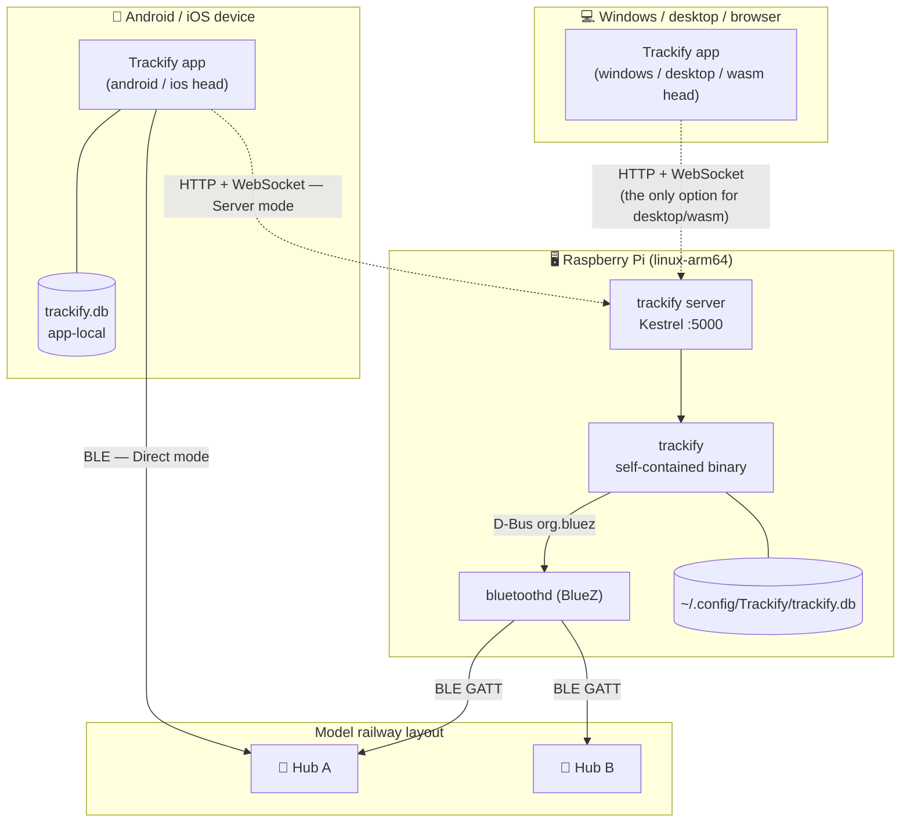
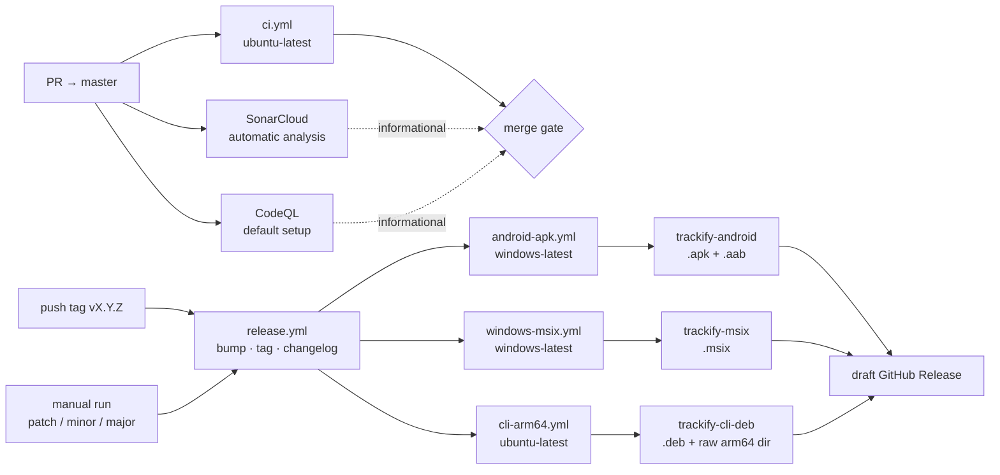

# 7. Deployment View

Trackify has three deployment shapes: **local-only** (one device does everything), **client/server**
(a Pi owns the radio, phones drive it), and **headless** (a Pi runs the layout with nobody watching).
The same artifacts serve all three.

## 7.1 Infrastructure overview



| Node | Runtime | Trackify artifact | Radio |
|---|---|---|---|
| Android device | Android, .NET 10 | `net10.0-android` APK | Plugin.BLE 3.0.0 → Android BLE |
| iOS device | iOS, .NET 10 | `net10.0-ios` (requires a macOS build host) | Plugin.BLE → CoreBluetooth |
| Windows PC | Windows 10 19041+ | `net10.0-windows10.0.19041.0` | SharpBrick `.WinRT` |
| Desktop (Skia) / browser | .NET 10 / WASM | `net10.0-desktop`, `net10.0-browserwasm` | **none** — Server mode only |
| Raspberry Pi / Linux server | linux-arm64 (or x64) | self-contained `trackify` binary | BlueZ via D-Bus |
| Dev Windows box | Windows | CLI `net10.0-windows…` TFM | WinRT — so `discover`/`drive` work while developing |

> **The CLI has two flavours on purpose.** The plain `net10.0` build is what ships to the Pi (BlueZ,
> selected at runtime). On a Windows dev box the project *also* targets `net10.0-windows…`, where the
> `WINDOWS` symbol makes `AddTrackifyApplication` compile in `AddWindowsLego` — so the CLI can drive
> real hubs during development. The plain build reports "Bluetooth is not available" off-Linux.

## 7.2 Raspberry Pi — bare deployment

**Build** (from any OS; no build flags needed, because BlueZ is always compiled in and selected at
runtime):

```bash
dotnet publish Source/Trackify.Cli/Trackify.Cli.csproj -c Release -r linux-arm64 \
  --self-contained -o publish/
scp -r publish/ pi@raspberrypi:/opt/trackify/
ssh pi@raspberrypi 'chmod +x /opt/trackify/trackify'
```

Self-contained means the Pi needs no .NET runtime. `cli-arm64.yml` produces exactly this artifact
(`trackify-cli-linux-arm64`) for every release.

> **This is the manual route, kept for non-Debian Linux.** On a Raspberry Pi prefer the `.deb` that
> every release ships: `sudo apt install ./trackify_<version>_arm64.deb` does the publish, the BlueZ
> prerequisite, the service user and group, the store directory and the systemd unit in one step —
> see [§7.6](#76-build-and-delivery-pipeline) and
> [`Source/Trackify.Cli/ReadMe.md`](../../Source/Trackify.Cli/ReadMe.md). Everything below is what
> the package automates, and remains the documented path when `apt` is not available.

**Prerequisite — BlueZ must be installed and the radio powered.** Raspberry Pi OS usually ships it;
Ubuntu Server images do **not**. The bundled idempotent script does the whole job:

```bash
sudo Source/Trackify.Cli/scripts/setup-bluez.sh
```

It installs `bluez` + `rfkill`, enables and starts `bluetoothd`, clears any soft-block, powers the
adapter, and adds the user to the `bluetooth` group (log out and back in afterwards, or a non-root
`trackify` is denied on D-Bus). `scripts/pi-bt-info.sh` is a read-only checker for when discovery
still misbehaves.

**Autostart** — `/etc/systemd/system/trackify.service`:

```ini
[Unit]
Description=Trackify LEGO train control
After=bluetooth.target
Requires=bluetooth.service

[Service]
ExecStart=/opt/trackify/trackify auto --interval 60
Restart=on-failure
RestartSec=5
User=pi
Environment=TRACKIFY_STORE=/home/pi/.config/Trackify/trackify.db
KillSignal=SIGINT

[Install]
WantedBy=multi-user.target
```

`KillSignal=SIGINT` is load-bearing — it routes `systemctl stop` into the clean-shutdown path in
[§6.5](06-runtime-view.md#65-clean-shutdown-the-safety-path) instead of killing the process with a
train still moving. Use `ExecStart=… auto` for the whole fleet or `… drive "Blauer Zug" --speed 40`
for a single train.

## 7.3 Raspberry Pi — Docker

```bash
docker compose up -d                       # build + run, restarts after reboot
docker compose logs -f                     # live Serilog output
docker compose run --rm trackify discover  # one-shot commands
docker compose down                        # stops the train cleanly (SIGINT)
```

A container has no radio of its own, so `docker-compose.yml` makes several specific concessions:

| Setting | Why |
|---|---|
| `network_mode: host` | BLE goes through the **host's** `bluetoothd`; a bridge network would isolate it |
| `volumes: /var/run/dbus:/var/run/dbus` | D-Bus socket access to `org.bluez` on the host |
| `group_add: ${BLUETOOTH_GID:-113}` | The image runs non-root, and BlueZ's D-Bus policy grants `org.bluez` to root and the `bluetooth` group only |
| `stop_signal: SIGINT` | `docker stop` must reach the clean-shutdown path, not `SIGTERM`-kill a moving train |
| `restart: unless-stopped` | Survives reboots |

**The image runs as the non-root `app` user** (`USER $APP_UID`, UID 1654, supplied by the .NET base
image). That resolves `docker:S6471`, but it moves two requirements onto the host, both one-time:

1. **`bluetooth` group membership** — via `group_add`, using the host's actual GID
   (`getent group bluetooth | cut -d: -f3`; commonly but not always 113).
2. **A writable store** — a bind-mounted `./data` keeps its host ownership, so it needs
   `sudo chown -R 1654:1654 data`.

Get either wrong and the symptom is a D-Bus `AccessDenied` or a permission error on `/data`. Adding
`user: "0:0"` to the service restores the previous root behaviour, which is the quickest way to
confirm that a failure really is the non-root switch.

> **Note on suppression.** An earlier attempt passed `sonar.issue.ignore.multicriteria` for
> `docker:S6471` as a scanner `/d:` parameter. It silently did nothing — issue exclusions are
> multi-value *server-side* settings that only apply when configured in the SonarCloud UI. The
> parameter was live for the analysis of `9299be9` and the issue still came back `OPEN`. Fixing the
> finding at the source was the durable answer. In hindsight it was doubly doomed: the scanner
> workflow carrying that parameter never published an analysis at all ([R-9](11-risks-and-technical-debt.md)),
> so nothing it passed could have taken effect either way. The scanner has since been removed.

## 7.4 Server mode (client/server)

On the Pi:

```bash
trackify server --urls http://0.0.0.0:5000
```

The bind address comes from `appsettings.json` (`"Urls": "http://0.0.0.0:5000"`) unless `--urls`
overrides it. `Trackify:Server:DiscoverTimeoutSeconds` (default 20) caps how long a `POST
/api/discover` may scan.

In the app: switch to **Server mode** and enter `http://<pi-ip>:5000`. The setting persists in local
app settings, so it survives a restart; `RemoteTrainSync` then pulls the Pi's trains into the app's
local SQLite store, de-duplicating by hub identity (`HubId` → `BleAddress` → `Name`).

**Trust boundary.** The backend has no authentication, no TLS, and permissive CORS (deliberately
without credentials, avoiding the unsafe any-origin + `AllowCredentials` combination). It is designed
for a **trusted home LAN** and must not be exposed to the internet — see
[ADR-15](09-architecture-decisions.md#adr-15-no-authentication-or-tls-on-the-lan-backend) and
[§11](11-risks-and-technical-debt.md).

## 7.5 Data placement

| Data | Location | Notes |
|---|---|---|
| Train configuration | `~/.config/Trackify/trackify.db` (Linux) · `%APPDATA%\Trackify\trackify.db` (Windows) | Overridable with `TRACKIFY_STORE`. Schema created by `EnsureCreated()`; enums stored as readable names |
| App/CLI on one machine | Same file — they share the schema | Copy the `.db` to the Pi, or point both at one path |
| App in Server mode | Its own local store, refreshed by `RemoteTrainSync` | The Pi remains the source of truth while in Server mode |
| Last-known speeds | `TrainStateStore`, **in memory only** | Lost when the server restarts; by design, since real hub state is re-established on reconnect |
| Logs | stdout (Serilog console sink) → `journalctl -u trackify` or `docker compose logs` | Levels and sinks configured in `appsettings.json` |

## 7.6 Build and delivery pipeline



| Workflow | Trigger | Runner | Does |
|---|---|---|---|
| `ci.yml` | PR / push to `master` | ubuntu-latest | Builds the CLI + shared core, runs the tests. **The pre-merge gate** |
| `release.yml` | tag `v*.*.*` **or** manual | ubuntu-latest | Resolves the version (checks the tag, or bumps patch/minor/major and tags), builds the changelog, calls the three build workflows, opens a **draft** release carrying every artifact |
| `android-apk.yml` | manual / called | windows-latest | JDK 17 + `android` workload, `-f net10.0-android`, `AndroidPackageFormats=apk;aab` → `trackify-android` |
| `windows-msix.yml` | manual / called | windows-latest | `-f net10.0-windows10.0.19041.0`, side-load MSIX → `trackify-msix` |
| `cli-arm64.yml` | manual / called | ubuntu-latest | `-f net10.0 -r linux-arm64 --self-contained`, then `dpkg-deb` → `trackify-cli-deb` + `trackify-cli-linux-arm64` |

**Two entry points, one orchestrated run.** Versions are Semantic Versions and tags are `vX.Y.Z`.

1. **Push a tag `vX.Y.Z`** — releases exactly that commit. The tag must equal `TrackifyVersion`, or
   the run fails rather than ship artifacts labelled with a version nobody chose.
2. **Run `release.yml` manually** and pick `patch` / `minor` / `major` — it computes the next
   version with [`bump-version.sh`](../../.github/scripts/bump-version.sh), rewrites
   `Directory.Build.props`, commits, tags and pushes, then releases that commit. No tagging by hand.

Both paths live in **one** workflow on purpose: a tag pushed with `GITHUB_TOKEN` does **not** trigger
other workflows (GitHub blocks that recursion), so a separate "prepare release" workflow would create
a tag that never started a build. Staying in the same run avoids needing a personal access token.
The manual path pushes the version bump to the default branch, so that branch has to accept a push
from `github-actions[bot]`; if it is protected, use the tag path instead.

The three build workflows are **reusable** (`workflow_call`), so each build has exactly one
definition, and each also keeps its own `workflow_dispatch` that produces artifacts and publishes
nothing — that is how a packaging change gets tested without creating a release.

**Versioning has a single source of truth:** `TrackifyVersion` in
[`Directory.Build.props`](../../Directory.Build.props). `Version`, the Uno app's
`ApplicationDisplayVersion`, the derived `ApplicationVersion`, the `.deb` version and the release
title all come from it, and the builds receive it as `-p:TrackifyVersion=…` rather than counting
anything up in a file.

**The `versionCode` formula and its limits.** Android refuses an update whose `versionCode` is not a
strictly larger integer than the installed one, and iOS treats `CFBundleVersion` the same way. That
integer is derived — not maintained — as `major × 10000 + minor × 100 + patch`, so `1.2.3` → `10203`.
Two consequences worth knowing before they bite:

- **minor and patch must stay below 100.** `1.0.100` would collide with `1.1.0` (both 10100). Bump
  the minor instead of running a patch number into three digits.
- The formula is monotonic only while that holds; it is checked nowhere, because the realistic
  failure (a rejected Play Store upload) is loud and this project's numbering is nowhere near 100.

**Windows is the deliberate exception.** An MSIX package version has four parts, and Uno composes it
as `$(ApplicationDisplayVersion).$(ApplicationVersion)` — which would put the version code in the
fourth part. The **Microsoft Partner Center reserves that part and rejects any Store package whose
fourth part is not `0`**, so `Trackify.csproj` pins `ApplicationVersion` to `0` for the Windows head
alone. The MSIX version is therefore exactly `TrackifyVersion` + `.0` (`1.2.3` → `1.2.3.0`), and
ordering still works because the first three parts carry the Semantic Version. The practical rule
this creates: **a Windows build must never be handed `-p:ApplicationVersion=…`**, or it would
override the `0` and produce a package the Store refuses; `windows-msix.yml` passes only
`-p:TrackifyVersion`.

The non-SemVer `Alpha` tag predates all of this: every lookup of "the previous release" globs
`v[0-9]*.[0-9]*.[0-9]*` so it can never be mistaken for one.

**Store formats.** Google Play accepts only an **`.aab`**, which cannot be installed directly, so the
Android job emits `apk;aab` from one compile — the APK for side-loading, the AAB for Play. The
Microsoft Store takes the **`.msix`**; a Store *submission* would additionally want
`UapAppxPackageBuildMode=StoreUpload` (a `.msixupload`), which this pipeline does not produce, since
its MSIX is built for side-loading.

**Signing is optional and off by default**, because the keystore and the certificate belong to the
maintainer. Without the secrets the pipeline still completes: the APK is debug-signed (side-loadable,
not distributable) and the MSIX is unsigned (Windows will not install it until it is signed). Adding
`ANDROID_KEYSTORE_BASE64` / `ANDROID_KEYSTORE_PASSWORD` / `ANDROID_KEY_ALIAS` /
`ANDROID_KEY_PASSWORD` and `WINDOWS_CERTIFICATE_BASE64` / `WINDOWS_CERTIFICATE_PASSWORD` as
repository secrets switches both to properly signed builds. Key material is decoded into
`RUNNER_TEMP`, outside every uploaded artifact path.

**Why MSIX and not an MSI.** The Windows head is WinUI 3 / Windows App SDK, where
`WindowsPackageType` already evaluates to `MSIX` and Uno.Sdk generates the `Package.appxmanifest`
from the csproj properties — so nothing extra is authored. An MSI would add WiX plus a separate
installer project, and an *unpackaged* WinUI app additionally needs the Windows App SDK runtime on
the target machine. MSIX also gives atomic install/uninstall, per-user install without admin, and an
update path. iOS is absent from the pipeline entirely: it needs a macOS build host.

**Why a `.deb` for the Pi** rather than a tarball, a single-file binary or only the Docker image:
`apt install ./trackify_<version>_arm64.deb` is the one command that also pulls in `bluez`
(`Depends:`), creates the service user, puts it in the `bluetooth` group, makes `/var/lib/trackify`
and registers the systemd unit — the four steps that are otherwise manual
([§7.2](#72-raspberry-pi--bare-deployment)). The unit is installed but **not enabled**: `apt install`
has no business setting a physical layout in motion. The raw `linux-arm64` directory is still
published for non-Debian Linux. Packaging lives in [`packaging/debian/`](../../packaging/debian) and
[`.github/scripts/build-deb.sh`](../../.github/scripts/build-deb.sh).

**The changelog is generated, not maintained.** [`release-notes.sh`](../../.github/scripts/release-notes.sh)
lists every non-merge commit since the previous `v*` tag — no Conventional Commits machinery and no
file to keep in sync. `release.yml` checks out with `fetch-depth: 0`, because that walk needs the
full history and all tags.

Two analyses run **without a workflow file in this repo**, so they have no `.yml` to read:

| Analysis | Configured by | Notes |
|---|---|---|
| SonarCloud | [`.sonarcloud.properties`](../../.sonarcloud.properties) + the GitHub app | **Automatic analysis** — never builds, so it reports no coverage and analyses C# without a compilation. A scanner workflow cannot coexist with it → [R-9](11-risks-and-technical-debt.md) |
| CodeQL | GitHub **default setup** (`dynamic/github-code-scanning/codeql`) | Runs `csharp`, `javascript-typescript` and `actions`. Configured in the repo's Security settings, not in version control |

All workflows provision the .NET 8, 9 and 10 SDKs; `global.json` pins `10.0.0` with
`rollForward: latestMajor`, so the newest installed major is used.

**The Uno app is intentionally not built by `ci.yml`.** Its five heads trigger workload imports and
OS-locked TFMs (iOS needs macOS, Windows needs Windows) during *restore*, even with `-f <head>` — so
gating one head reliably would need a per-OS + workload matrix. The Android head is covered by
`android-apk.yml`; the remaining heads are verified locally. The app is out of the SonarCloud scope
too, for a related but distinct reason: automatic analysis never builds anything, so its C# findings
on the app are noise rather than results. → [§11](11-risks-and-technical-debt.md)

**Local verification** (what a change is expected to pass before it is pushed):

```bash
dotnet build Source/Trackify.Cli/Trackify.Cli.csproj
dotnet test  Test/Trackify.Tests/Trackify.Tests.csproj
dotnet build Source/Trackify/Trackify.csproj -f net10.0-desktop
dotnet run --project Source/Trackify/Trackify.csproj -f net10.0-desktop   # launch smoke test
```

Buildable heads outside macOS: `net10.0-android`, `net10.0-desktop`, `net10.0-browserwasm`,
`net10.0-windows10.0.19041.0`. Real BLE behaviour is confirmed on a device and on a Pi — it cannot be
exercised in CI.

**Checking SonarCloud's C# rules locally — the authoritative check.** Because the hosted analysis
never compiles the code ([R-9](11-risks-and-technical-debt.md)), its C# findings cannot be trusted and
a fix cannot be confirmed there. Run the same rules offline instead, by injecting the analyzer package
without touching any repo file: write

```xml
<Project><ItemGroup>
  <PackageReference Include="SonarAnalyzer.CSharp" VersionOverride="10.31.0.145097" PrivateAssets="all" />
</ItemGroup></Project>
```

to a scratch file and pass it as `CustomAfterMicrosoftCommonProps`:

```bash
dotnet build Test/Trackify.Tests/Trackify.Tests.csproj -t:Rebuild \
  -p:CustomAfterMicrosoftCommonProps=<path> \
  -p:TreatWarningsAsErrors=false -p:EnforceCodeStyleInBuild=false
```

Building the **test** project covers the whole analysed scope, since it references the core libs and
the CLI. `VersionOverride` bypasses Central Package Management; the two overrides stop warnings-as-errors
from aborting the build before every rule has reported. Keep the version in step with the
`sonar.cs.analyzer.dotnet.pluginVersion` the server reports. Non-C# rules (docker, XML, YAML,
JavaScript) have no local equivalent — reason about those from the rule description.
